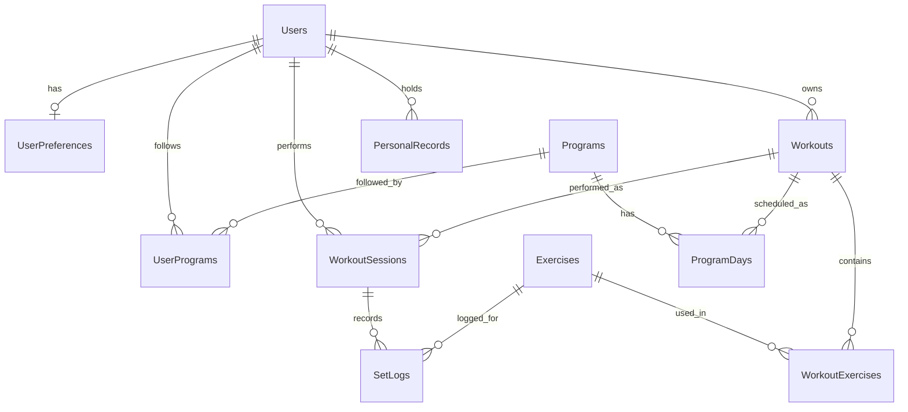

# Krypton — Project Specification

Krypton is a workout app for people who train **at home or in the gym**. Users follow coach-made programs, build their own workouts, log every set during a live session, and track their progress over time.

This document describes what Krypton is, the product rules, the data model, the API, and the order to build it in, so that the backend matches the approved demo (mobile + web).

- **Backend:** ASP.NET Core Web API (.NET 10), SQL Server, EF Core (+ a few stored procedures)
- **Mobile app:** Flutter (main place to *do* workouts)
- **Web app:** Angular (planning, reviewing progress, admin panel)
- All three clients talk to **one API and one database**.

---

## How we're building this

I (the developer) write all the code myself. Claude acts as a senior developer mentoring a junior: explaining concepts, reviewing code, answering "why" something is right or wrong, flagging gaps, and walking through design tradeoffs — but does not write or edit code unless I explicitly ask for it. When I'm stuck, Claude teaches first and lets me apply the fix myself.

The goal isn't to get Krypton built fast — it's for me to build the judgment to make these architectural and implementation decisions on my own, so this skill transfers to any future project, not just this one.

---

## 1. Product rules (read these first)

These rules drive the whole design. Every endpoint must respect them.

1. **Two kinds of workouts**
   - **System workouts (coach plans):** created by admins, part of Krypton Programs. Users can view, start and copy them, but **never edit or delete** them.
   - **User workouts ("My Workouts"):** created by a user or copied from a system workout. Only their owner can edit or delete them.
2. **"Save a copy & customize":** copying a system workout creates a new user-owned workout with the same exercises, sets, reps and rest. The copy remembers where it came from (`SourceWorkoutId`) but is fully independent afterwards.
3. **Exercise library is admin-managed.** Users browse and filter exercises; only admins create, edit or deactivate them.
4. **Plans vs performance are separate.** A workout is a *template*. Doing it creates a *session* with *set logs*. Editing a workout later must never change past sessions.
5. **Soft delete** for exercises and programs (`IsActive = false`), because old sessions still reference them.
6. **Users only see their own data.** The user id always comes from the JWT, never from the request body.

---

## 2. Roles

| Role  | Can do |
|-------|--------|
| User  | Onboarding, browse programs and exercises, follow a program, manage own workouts, run sessions, view own progress and profile |
| Admin | Everything a user can, plus manage the exercise library and create/publish programs and system workouts |

---

## 3. Features and screens

Screens refer to the demo canvas (mobile `M` / web `W`).

### 3.1 Accounts and onboarding
- Register, log in, log out, change password, edit profile.
- Onboarding after registration: **goal** (lose weight / build muscle / stay fit), **level** (beginner / intermediate / advanced), **equipment** (none / dumbbells / full gym), **days per week** (2–5).
- Onboarding answers are used to recommend a program.
- Screens: M Login, M Onboarding, M Profile.

### 3.2 Discover programs (read-only)
- List published programs, filter by equipment and level, show a "Recommended for you" program.
- Program detail: weeks, days per week, and each day's workout (or rest day).
- Start a program (one active program per user at a time).
- Screens: M Discover, M Program workout, W Programs.

### 3.3 My Workouts
- List the user's own and copied workouts.
- Create, edit, delete own workouts; add exercises from the library with sets, reps and rest; reorder exercises.
- Copy a system workout into My Workouts.
- Screens: M My Workouts, M Customize workout, W My Workouts.

### 3.4 Exercise library (browse-only for users)
- Search by name, filter by equipment, category and muscle group, paginated.
- Each exercise later gets an image and an animation key (Rive) for the form guide.
- Screens: M Exercise Library, W Library manager (admin).

### 3.5 Live workout session
- Start a session from a program day or from any workout.
- For each exercise: show **previous values** (last time the user did it), log reps and weight per set, mark sets done.
- Rest timer with ±15 s adjustment (client side), timed exercises (e.g. plank) log seconds instead of reps.
- **Swap exercise** mid-workout (replace with another exercise for this session only).
- Finish or abandon the session.
- Screens: M Live Workout.

### 3.6 Completing a workout
- Summary: duration, sets, total reps, total volume (kg), new personal records.
- Updates streak, program progress and badges.
- Screens: M Workout Complete.

### 3.7 Progress and history
- Volume per week / month / year, workouts per period, muscle-group split, most-trained muscle.
- Personal records per exercise.
- Workout history list.
- Screens: M Progress, W Progress & history.

### 3.8 Home and dashboard
- Active program with "Day X of Y" and today's workout, weekly goal ring, streak, time trained, recent workouts.
- Screens: M Home, W Dashboard.

### 3.9 Admin: library manager
- Exercises: create, edit, deactivate.
- Programs: create as draft, add workout days, publish / unpublish.
- Screens: W Library manager (Exercises and Programs tabs).

---

## 4. Data model



### Tables

**Users**
| Column | Type | Notes |
|---|---|---|
| Id | int, PK | |
| Email | nvarchar(256) | unique, stored lower-case |
| PasswordHash | nvarchar(200) | BCrypt |
| DisplayName | nvarchar(100) | |
| Role | nvarchar(20) | `User` or `Admin` |
| CreatedAt | datetime2 | UTC |

**UserPreferences** (1:1 with Users)
Goal, Level, Equipment, DaysPerWeek, DefaultLocation (`Home`/`Gym`), WeeklyGoal, Units (`kg`/`lb`), RestAlerts (bit).

**Exercises**
| Column | Type | Notes |
|---|---|---|
| Id | int, PK | |
| Name | nvarchar(100) | unique |
| Category | nvarchar(20) | `Strength`, `Cardio`, `Mobility` |
| MuscleGroup | nvarchar(30) | Chest, Back, Legs, Shoulders, Arms, Core, FullBody |
| Equipment | nvarchar(30) | Bodyweight, Dumbbell, Barbell, Machine |
| TrackingType | nvarchar(20) | `Reps`, `RepsAndWeight`, `Time` |
| Description | nvarchar(max) | how to perform |
| ImageUrl | nvarchar(500) | nullable, later |
| AnimationKey | nvarchar(100) | nullable, Rive state machine name, later |
| IsActive | bit | soft delete |
| CreatedAt / UpdatedAt | datetime2 | |

**Workouts**
| Column | Type | Notes |
|---|---|---|
| Id | int, PK | |
| Name | nvarchar(100) | |
| OwnerUserId | int, FK, nullable | **null = system workout** (coach plan) |
| SourceWorkoutId | int, FK, nullable | set when copied from another workout |
| Location | nvarchar(10) | `Home` / `Gym` |
| EstimatedMinutes | int | |
| CreatedAt / UpdatedAt | datetime2 | |

**WorkoutExercises** (many-to-many with payload)
Id, WorkoutId, ExerciseId, OrderIndex, Sets, Reps (nullable), DurationSeconds (nullable), RestSeconds.

**Programs**
Id, Name, Description, Level, Equipment, Weeks, DaysPerWeek, Status (`Draft`/`Published`), IsActive, CreatedAt.

**ProgramDays**
Id, ProgramId, WeekNumber, DayNumber, WorkoutId (nullable = rest day), Title.

**UserPrograms**
Id, UserId, ProgramId, StartedAt, CurrentDay, Status (`Active`/`Completed`/`Abandoned`). One `Active` row per user (filtered unique index).

**WorkoutSessions**
Id, UserId, WorkoutId, ProgramDayId (nullable), StartedAt, CompletedAt (nullable), Status (`InProgress`/`Completed`/`Abandoned`), DurationSeconds, TotalSets, TotalReps, TotalVolumeKg, Note.

**SetLogs**
Id, SessionId, ExerciseId, SetNumber, Reps (nullable), WeightKg (nullable), DurationSeconds (nullable), IsCompleted, LoggedAt.

**PersonalRecords**
Id, UserId, ExerciseId, RecordType (`MaxWeight`, `MaxReps`, `MaxDuration`, `MaxVolumeSet`), Value, SessionId, AchievedAt.

**Later:** `Badges`, `UserBadges` for awards.

### Indexes to add
- `Users(Email)` unique
- `Exercises(Name)` unique; `Exercises(Equipment, MuscleGroup)` for filters
- `WorkoutSessions(UserId, CompletedAt)` for progress queries
- `SetLogs(SessionId)`, `SetLogs(ExerciseId)`
- `UserPrograms(UserId)` filtered unique where `Status = 'Active'`

---

## 5. API

All routes start with `/api`. JSON in and out. Errors return **ProblemDetails** with the right status code.

### Auth
| Method | Route | Notes |
|---|---|---|
| POST | `/auth/register` | 201 + token; 409 if email exists |
| POST | `/auth/login` | 200 + token; 401 on wrong email or password (same message) |
| POST | `/auth/change-password` | authorized |

### Me
| Method | Route | Notes |
|---|---|---|
| GET | `/me` | profile + preferences |
| PUT | `/me/preferences` | onboarding answers and settings |
| GET | `/me/dashboard` | data for Home / Dashboard in one call |

### Exercises
| Method | Route | Notes |
|---|---|---|
| GET | `/exercises?search=&equipment=&muscleGroup=&category=&page=&pageSize=` | paginated |
| GET | `/exercises/{id}` | 404 if missing or inactive |
| POST | `/admin/exercises` | Admin |
| PUT | `/admin/exercises/{id}` | Admin |
| DELETE | `/admin/exercises/{id}` | Admin, soft delete |

### Programs
| Method | Route | Notes |
|---|---|---|
| GET | `/programs?equipment=&level=` | published only |
| GET | `/programs/recommended` | based on preferences |
| GET | `/programs/{id}` | weeks, days, workouts |
| POST | `/programs/{id}/start` | creates UserProgram; 409 if one is already active |
| GET | `/me/program` | active program + today's day |
| POST | `/admin/programs` | Admin, draft |
| PUT | `/admin/programs/{id}` | Admin |
| POST | `/admin/programs/{id}/days` | Admin |
| POST | `/admin/programs/{id}/publish` | Admin |

### Workouts
| Method | Route | Notes |
|---|---|---|
| GET | `/workouts/mine` | user's own and copied workouts |
| GET | `/workouts/{id}` | system workout or own workout; 404 otherwise |
| POST | `/workouts` | create own workout |
| PUT | `/workouts/{id}` | **403 if system workout or not owner** |
| DELETE | `/workouts/{id}` | **403 if system workout or not owner** |
| POST | `/workouts/{id}/copy` | 201, new user-owned copy |

### Sessions
| Method | Route | Notes |
|---|---|---|
| POST | `/sessions` | body: workoutId, optional programDayId; 201 |
| GET | `/sessions/{id}` | includes previous values per exercise |
| POST | `/sessions/{id}/sets` | log a set |
| PUT | `/sessions/{id}/sets/{setId}` | edit a logged set |
| POST | `/sessions/{id}/swap` | replace an exercise for this session only |
| POST | `/sessions/{id}/complete` | **transaction**, returns summary + new PRs |
| POST | `/sessions/{id}/abandon` | |
| GET | `/sessions/history?page=` | |

### Progress
| Method | Route | Notes |
|---|---|---|
| GET | `/progress/summary?period=week|month|year` | volume buckets, counts, muscle split |
| GET | `/progress/records` | personal records |

---

## 6. Business logic

### Copy a workout
1. Load the source workout with its exercises (`Include`).
2. Allow only if it is a system workout or owned by the caller.
3. Create a new workout: `OwnerUserId = caller`, `SourceWorkoutId = source.Id`, name `"<name> (copy)"`.
4. Copy every WorkoutExercise row. Save once.

### Complete a session (one transaction)
1. Session must belong to the caller and be `InProgress`, otherwise 404 / 409.
2. Set `CompletedAt`, `Status = Completed`, `DurationSeconds`.
3. Calculate totals from completed SetLogs: sets, reps, volume (`reps × weight`).
4. Detect personal records per exercise and insert/update `PersonalRecords`.
5. If the session came from a program day, advance `UserPrograms.CurrentDay`; mark the program completed on the last day.
6. Commit. If any step fails, roll back everything.

### Previous values
For each exercise in a session, return the sets from the user's most recent completed session that contained that exercise.

### Streak
Count consecutive calendar days (user's time zone, later) ending today or yesterday that have at least one completed session.

### Recommended program
Match preferences: equipment first, then level, then closest days per week.

---

## 7. Backend structure

```
KryptonApi/
├── src/
│   └── Krypton.Api/
│       ├── Controllers/          Auth, Me, Exercises, Programs, Workouts, Sessions, Progress, Admin*
│       ├── Services/             business rules (+ Interfaces/)
│       ├── Repositories/         EF Core data access (+ Interfaces/)
│       ├── Models/
│       │   ├── Entities/
│       │   └── DTOs/             one folder per feature
│       ├── Data/
│       │   ├── KryptonDbContext.cs
│       │   ├── Configurations/   Fluent API per entity
│       │   ├── Seed/             exercises, programs, admin user
│       │   └── Migrations/
│       ├── Middleware/           global exception handling
│       ├── Common/               exceptions, settings (JwtSettings), extensions, constants
│       └── Program.cs
├── database/
│   ├── stored-procedures/
│   ├── seed/
│   └── queries/
├── tests/
│   └── Krypton.Api.Tests/
└── KRYPTON.md
```

**Conventions**
- Controllers are thin: receive the request, call a service, return the result.
- Services hold business rules and authorization checks (owner / system workout).
- Repositories only talk to the database. Use `AsNoTracking` for reads.
- Never return entities from the API; map to DTOs.
- Async all the way (`ToListAsync`, `SaveChangesAsync`).
- Throw custom exceptions (`NotFoundException`, `ForbiddenException`, `ConflictException`) and let the middleware map them to 404 / 403 / 409.
- Pagination response: `{ items, page, pageSize, totalCount }`.
- Secrets (JWT key, connection string) in user secrets / environment variables, not in Git.

### Stored procedures (in `database/stored-procedures/`)
- `usp_GetProgressSummary @UserId, @From, @To, @Bucket` — volume and counts per day/week/month.
- `usp_GetMuscleSplit @UserId, @From, @To` — share of sets per muscle group.
- `usp_GetWeeklySummary @UserId, @WeekStart` — used by the dashboard.

Called from EF Core with `Database.SqlQuery<T>($"EXEC ...")`.

---

## 8. Build plan

Each phase ends with working endpoints tested in Swagger (or a `.http` file) and a commit.

| Phase | Build | Done when |
|---|---|---|
| 1 | Project setup, DbContext, Exercises entity, migration, seed 30+ exercises | Database created and seeded |
| 2 | Exercises read endpoints: list with filters + pagination, get by id | Filters run in SQL (`IQueryable`) |
| 3 | Global exception middleware, validation, ProblemDetails | 400 / 404 / 409 are consistent |
| 4 | Auth: Users, register, login, JWT, roles, `/me` | `[Authorize]` and `Admin` policy work |
| 5 | Admin exercise CRUD | Users get 403 on admin routes |
| 6 | Workouts: entities, own CRUD, system workouts seeded, copy endpoint | Editing a system workout returns 403 |
| 7 | Programs: entities, seed 3 programs, list/detail/start, recommended | One active program per user |
| 8 | Sessions: start, log sets, previous values, swap, abandon | A full session can be logged |
| 9 | Complete session (transaction), PRs, program progress | Summary matches the demo's Complete screen |
| 10 | Progress: stored procedures, records, history, dashboard endpoint | Progress and Home screens can be fed |
| 11 | Preferences + onboarding | Recommendation uses preferences |
| 12 | Admin programs: draft, days, publish | New program appears in Discover |
| 13 | Performance pass: indexes, seed 100k set logs, `EXPLAIN`/execution plans, caching for exercises | Progress query fast on large data |
| 14 | Tests for key services (copy rules, complete session) | `dotnet test` passes |

**After the backend:** Angular web app (Dashboard, Programs, My Workouts, Progress, Admin), then Flutter mobile app (Live Workout first), then Rive form-guide animations, exercise images, and deployment (Azure App Service + Azure SQL + Key Vault + GitHub Actions).

---

## 9. Seed data

- Admin user (credentials from configuration, never hard-coded).
- 30+ exercises covering bodyweight, dumbbell, machine and cardio, every muscle group.
- Programs: **30-Day Home Beginner** (no equipment), **Dumbbell Strength** (6 weeks), **Push Pull Legs** (gym, 8 weeks), each with system workouts per day.

---

## 10. Out of scope for version 1

Social features and friend challenges, watch and Health Connect / Apple Health integration, AI-adjusted plans, nutrition, payments and premium tier, push notifications, offline sync.

---

## 11. Interview topics covered by this project

| Topic | Where in Krypton |
|---|---|
| REST, status codes, routing | All controllers |
| Dependency injection lifetimes | Services and repositories (Scoped) |
| Middleware pipeline | Exception middleware, auth order |
| JWT, authentication vs authorization, roles | Auth, admin routes, owner checks |
| EF Core relationships, `Include`, N+1 | Workouts ↔ Exercises, Programs ↔ Days |
| `IQueryable` vs `IEnumerable`, pagination | Exercise filters |
| Transactions, ACID | Complete session |
| Stored procedures, aggregation, indexes | Progress |
| Encapsulation, business rules | System vs user workouts |
| Caching | Exercise library |
| Unit testing | Service tests |
